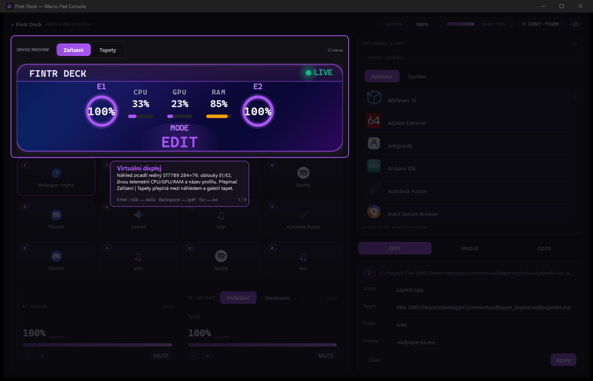

# Fintr Deck

DIY makro keypad ve stylu Stream Deck — 12 mechanických kláves, dvojice
rotačních enkodérů, širokoúhlý IPS displej a desktopová konzole s přehledným
tmavým designem. Klávesy se přemapovávají v aplikaci tažením — bez
přeflashování firmwaru.

**Firmware** jede na ESP32 (Arduino / PlatformIO), **konzole** je napsaná v
Pythonu (PySide6). Hloubka displeje, tapety a telemetrie se přenáší po USB.

> 💡 *Demo video (průvodce aplikací + reálné ovládání) přidám do
> `docs/demo.mp4` — dokud chybí, mrkni na screenshoty níže.*


Interaktivní průvodce (spustí se sám při prvním spuštění, znovu v Nastavení):



## Funkce

### 12 mechanických kláves (matice 4×3)
- **Spouštění aplikací** — automatická detekce nainstalovaných programů
  ve Windows včetně extrakce ikon; klik = spustit/focus, drag & drop =
  přiřazení ke klávese
- **Hotkey Recorder** — klikni a nahravej klávesovou zkratku
- **Mediální klávesy** — play/stop/next/prev/volume/mute
- **3 profily** (EDIT / MEDIA / CODE) — přepínání z aplikace; stisk klávesy se
  v konzoli rozsvítí s 2s plynulým fade-outem
- **Kalibrace matice** — vestavěný průvodce naučí firmware fyzické rozložení
  tlačítek (mapa se ukládá do NVS v ESP32)

### Širokoúhlý 2.25" IPS displej ST7789 (284×76 px)
- **Živá telemetrie CPU / GPU / RAM** (1 Hz) — NVIDIA přes NVML, AMD a iGPU
  přes Windows PDH, bez práv správce
- Indikátory enkodérů (oblouky + %), aktivní profil, stav připojení
- **Vlastní tapety** — obrázek se v PC vyřeže na 284×76, převede do RGB565
  a pošle do framebufferu přes USB (ACK řízený přenos bloků)
- přenáší se i celý design frame (tapeta + chrome) → firmware kreslí jen
  dynamické hodnoty, žádné blikání

### 2× rotační enkodér EC11
- **E1** — nativní ovládání systémové hlasitosti Windows + mute stiskem
- **E2** — plně konfigurovatelný: hlasitost/mute konkrétní aplikace
  (drag & drop z knihovny), scroll, zoom nebo vlastní hotkey
  (zvlášť pro otáčení vlevo, vpravo a stisk)

### PC konzole (Fintr Deck)
- tmavý design s přizpůsobitelným barevným motivem (presety + vlastní barva,
  accent se promítne i na displej zařízení)
- **interaktivní průvodce** (Product Tour) — po každé funkci, včetně mini
  průvodce přímo v Nastavení; lze kdykoliv spustit znovu
- režim simulace (klikací klávesy + enkodéry bez HW), sériový terminál,
  živý náhled displeje, auto-detekce COM portu (VID/PID), auto-reconnect

## 3D model & konstrukce (Fusion 360)

- 3D tištěné šasi (PLA/PETG), **kouřový plexi/akrylátový horní kryt**
- zadní **výklopné nožičky** se zacvakávacím pantem (printed-in-place)
- modely a doporučené nastavení tisku:
  [hardware/3d_model_fusion360/](hardware/3d_model_fusion360/README.md)

## Seznam součástek (BOM)

| Součástka | Počet |
|-----------|-------|
| ESP32 DevKit v1 (30 pinů) | 1 |
| ST7789 2.25" IPS 76×284 | 1 |
| EC11 enkodér s push tlačítkem | 2 |
| Mechanické spínače (MX kompatibilní) | 12 |
| Keycaps 1u | 12 |
| 3D tištěné šasi + kouřový akrylát 3 mm | 1 |
| M2.5/M3 šrouby, zapojovací vodiče, nepajivé pole (nebo PCB) | dle potřeby |

## Zapojení GPIO (ESP32 DevKit v1)

| Funkce | GPIO | Poznámka |
|--------|------|----------|
| ST7789 SDA (MOSI) | 23 | hardware VSPI |
| ST7789 SCL (SCLK) | 18 | |
| ST7789 CS | 5 | |
| ST7789 DC | 16 | |
| ST7789 RST | 4 | |
| ST7789 BLK (podsvícení) | 17 | aktivní LOW |
| Matice — řádky | 15, **2**, 19, 21 | GPIO2 = output (onboard LED zůstává nízko) |
| Matice — sloupce | 22, **12**, 13 | internal pull-up |
| Enkodér E1 — CLK / DT / SW | 32 / 33 / 25 | master volume |
| Enkodér E2 — CLK / DT / SW | 26 / 27 / 14 | konfigurovatelný |

> ⚠️ GPIO12 je strapping pin (MTDI). S pull-upem na bootu může deska nastavit
> flash napětí na 1,8 V. Na testované sestavě to funguje, ale pokud se deska
> nespustí, zkus GPIO12 přehodit (kalibrace matice si s přesunem poradí).

## Zprovoznění krok za krokem

### Krok 1 — firmware do ESP32

Otevři ve VS Code složku [`firmware/`](firmware/) (PlatformIO projekt)
nebo z příkazové řádky:

```powershell
cd firmware
pio run                 # build
pio run -t upload       # flash (přes USB)
pio device monitor -b 115200
```

Předkompilovaný `firmware.bin` je k dispozici v GitHub Releases
(export: `powershell -ExecutionPolicy Bypass -File firmware/export_firmware.ps1`).

### Krok 2 — PC konzole

```powershell
python -m pip install -r pc_app/requirements.txt
python pc_app/main.py               # auto-detekce portu + auto-connect
python pc_app/main.py --dry-run     # jen logovat akce
```

Release s hotovou binárkou `FintrDeck.exe` najdeš v GitHub Releases
(build: `python pc_app/build_release.py`).

### Krok 3 — první připojení

1. Spusť konzoli — auto-detekce najde ESP32 (CP210x/CH340/FTDI), stav vpravo
   nahoře ukáže `COMx · 115200` a `LIVE`.
2. Při prvním spuštění se spustí **interaktivní průvodce** (znovu v
   Nastavení → „Spustit průvodce aplikací").
3. Přetáhni aplikaci z knihovny na klávesu — binding se uloží. Pro matici
   použij **Nastavení → Kalibrace kláves**.

## Simulace ve Wokwi

Projekt obsahuje vlastní Wokwi čip emulující ST7789 76×284 (SPI, RGB565,
MADCTL), takže displej i firmware lze vyvíjet bez reálného panelu:

1. `pio run` ve `firmware/`
2. VS Code → příkaz `Wokwi: Start Simulator` v otevřené složce `firmware/`

Detaily: [docs/technicka-prirucka.md](docs/technicka-prirucka.md).

## Struktura repozitáře

```
pc_app/                       PC konzole (Python + PySide6)
  build_release.py            PyInstaller build → FintrDeck.exe
  bindings.example.json       výchozí bindingy
firmware/                     PlatformIO projekt (ESP32)
  src/main.cpp                firmware (matice, enkodéry, ST7789, protokol)
  chips/                      vlastní Wokwi čip displeje (C → WASM)
  diagram.json, wokwi.toml    Wokwi simulace
  export_firmware.ps1         export firmware.bin pro release
hardware/
  3d_model_fusion360/         Fusion 360 šasi + nastavení tisku
  pcb/                        KiCad interface deska (připravuje se)
docs/                         technická příručka, screenshoty, video
tools/                        pomůcky (generování ikony, testy enkodérů)
```

## Uživatelská data

`pc_app/bindings.json` si aplikace vytvoří sama (viz
[bindings.example.json](pc_app/bindings.example.json)); do repa nepatří.

## Licence

MIT — viz [LICENSE](LICENSE).
