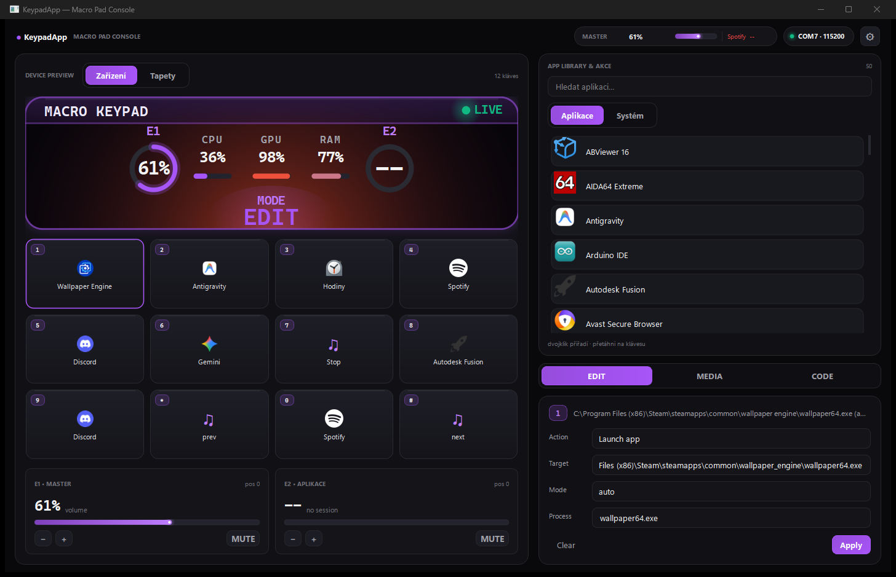

# Macro Keypad

A DIY macro keypad (Stream Deck-style) built around an ESP32: a 4×3 key matrix, two EC11 rotary
encoders and a 2.25" ST7789 strip display (76×284), paired with a PC companion app written in
Python + PySide6. Keys are remappable from the GUI — no reflashing required.

**Status:** firmware and PC app are complete and tested in simulation (including a custom Wokwi
display chip). Hardware bring-up in progress.

## Screenshots

PC companion app — live device preview, key binding grid, app library and action editor (UI is currently Czech):



## Features

**Firmware** (`src/main.cpp`, PlatformIO, ESP32 + Arduino framework)
- 12-key 4×3 matrix + 2 EC11 encoders with quadrature decoding and debounce
- Everything non-blocking (`millis()` based)
- ST7789 display shows the active profile, page names and live telemetry
- 3 profiles (EDIT / MEDIA / CODE), switchable from the PC
- Simple line-based serial protocol @ 115200 baud

**PC companion app** (`pc/KeypadApp`)
- GUI profile editor — rebind any key to an action without touching the firmware
- Action types: launch/focus app, hotkey, media key, type text, switch page
- Windows Core Audio integration (pycaw): encoder 1 = master volume/mute,
  encoder 2 = volume/mute of a chosen app, with the same percentages as the system mixer
- Telemetry (CPU / GPU / temperature) sent to the device display
- COM port auto-detection by USB VID/PID (CP210x, CH340, FTDI, Espressif), auto-reconnect
- Built-in simulation panel — click virtual keys/encoders to test bindings without hardware

**Wokwi simulation** (`chips/`)
- Wokwi has no 76×284 panel, so the project ships a custom display chip emulating the ST7789
  (SPI, RGB565, MADCTL rotations, native RAM centering 82/18) — compiled to WASM with `wokwi-cli`

## Serial protocol

Device → PC (one line per event):

| Line | Meaning |
|------|---------|
| `KEY:<char>` | key press (`1`–`9`, `*`, `0`, `#`) |
| `MACRO:<action>` | action of the key in the active profile |
| `ENC1:<pos>` / `ENC2:<pos>` | absolute encoder position |
| `ENC1_SW:1` / `ENC2_SW:1` | encoder button press |
| `PROFILE:<n>:<name>` | active profile changed |

PC → device (newline-terminated):

| Line | Meaning |
|------|---------|
| `T:CPU=45;GPU=30;TEMP=52` | update telemetry shown on the display |
| `P:<n>` | switch profile (1..3) |
| `N:<n>:<name>` | rename a page shown on the display |
| `H:<text>` | render test text on the display (5 s) |

## Hardware

| Component | Pins |
|-----------|------|
| ESP32 (uPesy WROOM devkit) | USB to PC, 115200 baud |
| Keypad matrix 4×3 | rows 22, 12, 13 · cols 15, 2, 19, 21 |
| Encoder 1 (EC11) | CLK 32 · DT 33 · SW 25 |
| Encoder 2 (EC11) | CLK 26 · DT 27 · SW 14 |
| ST7789 76×284 | MOSI 23 · SCK 18 · CS 5 · DC 16 · RES 4 · BLK 17 |

Full wiring, default key maps and troubleshooting: [NOTES.md](NOTES.md).

## Getting started

### Firmware

```powershell
pio run              # build
pio run -t upload    # flash a real board
pio device monitor -b 115200
```

> Build artifacts are redirected to `C:/Temp/keypad_build` in `platformio.ini` because the Xtensa
> linker fails on non-ASCII paths. For Wokwi, create a junction `wokwi_build` → `C:\Temp\keypad_build`
> (see NOTES.md § 5).

### PC app

```powershell
python -m pip install -r pc/KeypadApp/requirements.txt
python pc/KeypadApp/main.py            # auto-detects the COM port and connects
python pc/KeypadApp/main.py --dry-run  # log actions only
```

Key bindings live in `pc/KeypadApp/bindings.json` (generated with defaults on first run,
kept out of the repository).

### Simulation

Open the project in VS Code with the Wokwi extension and run `Wokwi: Start Simulator`
(uses `diagram.json`, `wokwi.toml` and the custom chip in `chips/`).

## Repository layout

```
src/            firmware (single-file Arduino sketch)
chips/          custom Wokwi ST7789 display chip (C source + chip.json + WASM)
pc/KeypadApp/   Python + PySide6 companion app
pc/KeypadHost.ps1  legacy PowerShell host (sim/replay tool)
cad/            Fusion 360 mechanical design (models + renders)
print/          3D print files (STL/3MF, slicer notes, BOM)
pcb/            KiCad interface board (schematic, layout, gerbers)
hw_test/        bare-metal HW bring-up sketch
tools/          helper scripts
docs/images/    screenshots for this README
diagram.json    Wokwi wiring
NOTES.md        technical manual: protocol, key maps, build, troubleshooting
```

The `cad/`, `print/` and `pcb/` folders describe their expected contents and are
filled as the mechanical design and PCB layout progress.

## Roadmap

1. HW bring-up — display, encoders, then the 4×3 key matrix (in progress)
2. PC app ↔ real COM port roundtrip (blocked on ESP32 USB detection)
3. On-display telemetry + encoder/volume widgets — done
4. App UI — device preview, app library with icons, drag&drop binding editor,
   wallpapers, theming — done
5. Mechanical: Fusion enclosure + 3D-printed parts (`cad/`, `print/`)
6. Electronics: KiCad interface board replacing the breadboard (`pcb/`)

## License

MIT — see [LICENSE](LICENSE).
